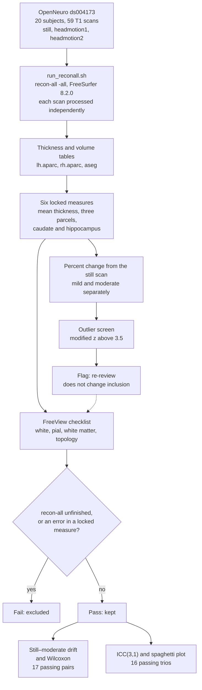
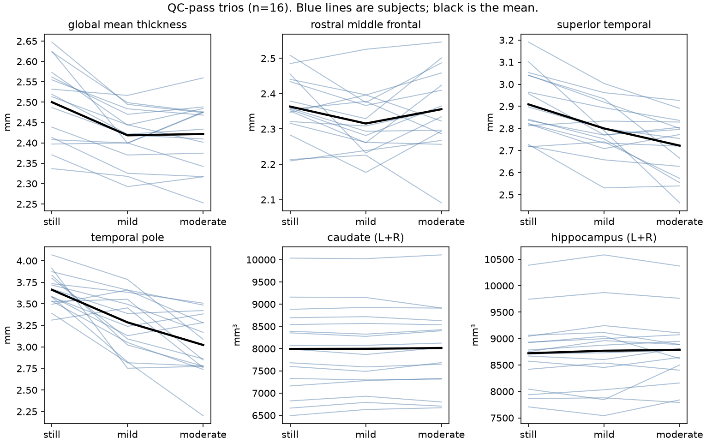

# MRART_Demo_Project

FreeSurfer recon-all on 20 subjects × 3 motion conditions from the MR-ART dataset (ds004173), quantifying how cortical thickness estimates drift under increasing head motion. This is a partial replication of Reuter et al. (2015; doi: [10.1016/j.neuroimage.2014.12.006](https://doi.org/10.1016/j.neuroimage.2014.12.006)). Intended as a pipeline-competence artifact rather than a novel publication.

**Author:** Jolane Abrams  
**Contact:** [jkabrams@alumni.usc.edu](mailto:jkabrams@alumni.usc.edu) | [https://www.linkedin.com/in/jolane-abrams-309b3412/](https://www.linkedin.com/in/jolane-abrams-309b3412/)

---

## Abstract

Head motion degrades structural MRI morphometry, but the magnitude of that degradation is rarely shown end-to-end with a public dataset. Twenty subjects from MR-ART (OpenNeuro ds004173) were each scanned at rest and under mild and moderate head motion (59 T1-weighted scans; one mild scan was never reconstructed). Every scan was reconstructed independently with FreeSurfer 8.2.0. The project is a partial replication of Reuter et al. (2015): head motion reduces gray-matter volume and thickness estimates, and the bias remains after scans that fail quality control are excluded. Percent change from each subject’s still scan was calculated for both mild and moderate motion. The pre-specified tests compare still with moderate. On the 17 pairs that passed a written surface checklist, median bilateral mean thickness was 3.39% lower under moderate motion (IQR −3.98 to −2.30; Holm p = 0.0015). Superior temporal thickness fell 5.26%, and temporal pole 18.01%. Caudate and hippocampus stayed near zero. Including the three failed moderate scans left the global-thickness median at −3.39%. Across still, mild, and moderate, ICC(3,1) on the 16 passing trios was 0.78 for global mean thickness and 0.35 for temporal pole. Reuter et al. reported about 0.7% gray-matter volume loss per mm/min; these results are contrasts between labeled conditions and have no mm/min measure.

---

## Replication context

This project is a partial replication of:

Reuter M, Tisdall MD, Qureshi A, Buckner RL, van der Kouwe AJW, Fischl B. Head motion during MRI acquisition reduces gray matter volume and thickness estimates. *NeuroImage*. 2015;107:107-115. doi:[10.1016/j.neuroimage.2014.12.006](https://doi.org/10.1016/j.neuroimage.2014.12.006)

### Original study

Reuter et al. scanned 12 healthy volunteers within a single session under different motion conditions (still, nod, shake, free motion). Using FreeSurfer 5.3, VBM8 SPM, and FSL Siena 5.0.7, they found an average apparent volume loss of roughly 0.7%/mm/min of subject motion, with effects varying across regions. Critically, the bias remained significant after excluding scans that failed a rigorous quality check — motion bias is directional, not just added noise.

### This project

- Dataset: MR-ART (OpenNeuro ds004173), 20 subjects × 3 motion conditions (still, mild, moderate)
- Software: FreeSurfer 8.2.0 (vs. 5.3 in the original)
- Estimand: within-subject percent change from the still scan
- QC: pre-specified outlier screen (Iglewicz–Hoaglin modified z on percent change) plus a written surface/WM/topology checklist
- Separation of flags (re-review) from fails (checklist-based exclusion), motivated by the original finding that bias survives QC exclusion

### What's different

- Larger sample (20 vs. 12)
- Condition labels rather than mm/min motion quantification — effect sizes are not directly comparable
- FreeSurfer-only (original tested three pipelines)
- Pre-specified measures (six locked ROIs) rather than whole-brain morphometry
- Explicit flag-vs-exclusion documentation

### What replicates

- Thickness moves in the same direction as the original. On the 17 passing still–moderate pairs, median change was −3.39% for global mean thickness, −5.26% for superior temporal, and −18.01% for temporal pole. All three remain below 0.05 after Holm correction.
- The shift is already present in scans that passed the checklist. Including the three failed moderate scans leaves the global-thickness median at −3.39%. The temporal-pole median moves from −18.01% to −20.85%.
- Caudate and hippocampus do not follow that pattern. Their medians are near zero (+0.42% and +0.83%) and do not survive Holm correction. A null here describes only those two structures.
- The original rate, about 0.7% gray-matter volume loss per mm/min and about 1.5% cortical thinning per mm/min in the most affected cortex, is not a numerical match. This project has condition labels rather than mm/min.

---

## Data

**Dataset:** MR-ART (Movement-Related ARTefacts)  
**Repository:** [OpenNeuro ds004173](https://openneuro.org/datasets/ds004173)  
**DOI:** [10.18112/openneuro.ds004173.v1.0.2](https://doi.org/10.18112/openneuro.ds004173.v1.0.2)

The MR-ART dataset contains T1-weighted 3D structural MRI images of 148 healthy adults, each scanned three times under increasing head motion (still, mild, moderate). All scans are anonymized, BIDS-organized, and defaced.

**Subset used:** First 20 subjects, **59 T1 scans** (not 60). `sub-105822` has no `acq-headmotion1` (mild) scan. Subject labels are non-sequential 6-digit IDs (e.g., `sub-000103`).

### Download command

```bash
source ~/venvs/neuro/bin/activate
openneuro-py download --dataset ds004173 --include sub-000103  # repeat for each of 20 subjects
```

## Pipeline overview

Each T1 is reconstructed on its own. The outlier screen can only send a scan back to the slices. Inclusion changes only at the checklist.



## Environment

### Software versions

| Component | Version | Installation |
| --- | --- | --- |
| macOS | 26.6.2 | |
| Python | 3.12.2 | Homebrew / python.org |
| FreeSurfer | 8.2.0 | freesurfer.net |
| XQuartz | 2.8.6 | xquartz.org |
| openneuro-py | 2026.7.1 | |
| pandas | 3.0.5 | |
| matplotlib | 3.11.1 | |
| seaborn | 0.13.2 | |
| pingouin | 0.6.1 | |
| nibabel | 5.4.2 | |

### Virtual environment setup

```bash
python3 -m venv ~/venvs/neuro
source ~/venvs/neuro/bin/activate
python3 -m pip install openneuro-py pandas matplotlib seaborn pingouin nibabel
```

### Environment variables

```bash
export SUBJECTS_DIR=$HOME/mrart_demo/fs_subjects
export FREESURFER_HOME=/usr/local/freesurfer/8.2.0  # Adjust to your install
source $FREESURFER_HOME/SetUpFreeSurfer.sh
```

### Directory structure

```text
~/mrart_demo/
├── ds004173/                 # Raw BIDS data (downloaded)
│   ├── sub-000103/
│   │   └── anat/
│   │       ├── *_acq-standard_T1w.nii.gz
│   │       ├── *_acq-headmotion1_T1w.nii.gz
│   │       └── *_acq-headmotion2_T1w.nii.gz
│   ├── sub-000148/
│   └── ... (19 more subjects)
├── fs_subjects/              # FreeSurfer outputs
│   ├── mrart_sub-000103_acq-standard/
│   ├── mrart_sub-000103_acq-headmotion1/
│   └── ... (57 more subjects)
├── logs/                     # Per-subject recon-all logs
├── run_reconall.sh           # Batch script
├── README.md                 # This file
└── .gitignore
```

## Quality control

Inclusion changes only when a scan fails the written checklist below, or when `recon-all` did not finish. The quantitative outlier screen is a re-review list. It does not fail a scan.

The screen is `analysis/outlier_screen.py`. It is applied separately to still→mild (`acq-headmotion1`) and still→moderate (`acq-headmotion2`) percent change, `100 × (motion − still) / still`, on six locked measures: bilateral mean thickness, rostral middle frontal, superior temporal, temporal pole, caudate (L+R), and hippocampus (L+R). A robust flag is an Iglewicz–Hoaglin modified z above 3.5 (`0.6745 × (x − median) / MAD`), with the median and MAD taken inside that measure and that contrast. Tukey 1.5×IQR and an ENIGMA-style z (±2.698) are stored alongside and are not a second exclusion rule. Outputs: `tables/outlier_screen.csv`, `tables/outlier_screen_pivot.csv`, and `tables/outlier_screen_heatmap.png`. Both contrasts are already in that table (234 rows: 6 measures × 19 mild pairs + 6 × 20 moderate pairs). `sub-105822` has no mild scan. The screen was not rerun after the checklist was completed.

Six measures were locked before the screen was used: bilateral mean cortical thickness; rostral middle frontal, superior temporal, and temporal pole thickness; and left-plus-right caudate and hippocampal volume. Mean thickness is the global cortical endpoint. The three parcels and two subcortical volumes were included so the same pre-specified screen covered regional thickness and subcortical volume. A scan fails visual quality control only when an error affects one of these endpoints. The same six are the pre-specified ROIs in the fail criteria below.

The set is not a representative sample of the cortex or of subcortical gray matter, and it is not the vertex-wise map reported by Reuter et al. (2015). Their strongest thinning was in precentral, postcentral, entorhinal, and parahippocampal cortex, and those regions are not in this list. A null result for caudate or hippocampus describes only those two structures.

Pass/fail calls from FreeView are recorded in `qc_reference/QC_checklist.xlsx`. The written criteria are in `qc_reference/FreeSurfer_QC_checklist.docx` and below.

The sheet has one call for each of the 59 reconstructed scans: 56 Pass and 3 Fail. All three fails are moderate scans: `sub-000103` (temporal pole, with rostral middle frontal and superior temporal noted as uncertain), `sub-009673` (caudate and hippocampus), and `sub-010769` (temporal pole). `sub-105822` mild is not on the sheet. That scan was never reconstructed. A robust flag on a scan marked Pass did not change inclusion.

### Surface QC checklist

**Purpose:** Pass/fail criteria applied during visual inspection of FreeSurfer recon-all outputs in FreeView. A scan fails only when one or more criteria below are met.

**Scope:** White surface, pial surface, white-matter boundaries, topology. Applied to all scans in the analysis set.

**Reviewer:** Jolane Abrams  
**Date:** 21 September - November 2026  
**FreeSurfer version:** 8.2.0  
**Viewer:** FreeView (XQuartz 2.8.6)

#### Procedure

For each scan, load recon-all outputs in FreeView and inspect:

- `orig` volume with white and pial surfaces overlaid
- `wm` (white-matter mask) against `orig`
- `aparc` and `aparc+aseg` segmentations
- Surface topology (holes, handles, non-manifold edges)

Inspect in coronal, sagittal, and axial planes. Pan through the full volume rather than sampling slices.

#### Pass criteria

A scan passes when all of the following hold.

**White surface**

- White surface follows the gray/white boundary in all lobes
- No regions where the white surface intrudes into gray matter or CSF
- No regions where the white surface excludes visible white matter
- Medial wall and midline structures correctly excluded

**Pial surface**

- Pial surface follows the outer gray matter boundary (CSF/gray interface)
- No regions where the pial surface extends into the skull, dura, or venous sinuses
- No regions where the pial surface collapses into white matter
- No large regions of over- or under-estimated cortical thickness

**White-matter boundaries**

- `wm` mask captures white matter without including gray matter or CSF
- Subcortical structures (caudate, putamen, thalamus, hippocampus, amygdala, ventricles) correctly segmented in `aseg`
- No obvious mislabeling at boundaries (for example hippocampus/amygdala confusion, or ventricle/white-matter confusion)

**Topology**

- No surface holes (defects) beyond incidental
- No handles or non-manifold edges
- `recon-all.done` marker present

#### Fail criteria

A scan fails when any of the following hold:

- `recon-all.done` marker absent (pipeline did not complete)
- White surface misalignment visible and not attributable to a known anatomical variant
- Pial surface extends outside the brain (into skull, dura, or sinus)
- `wm` mask includes non-white-matter tissue in a region that affects a pre-specified ROI
- Subcortical segmentation error in a region that affects a pre-specified ROI
- Topology defect (hole, handle) that affects a pre-specified ROI

A scan is not failed for minor surface imperfections that do not affect pre-specified ROIs. Surface reconstruction is imperfect in all scans; the question is whether the imperfection biases the measures being analyzed.

#### Pre-specified ROIs (for fail decisions)

A segmentation or topology error triggers a fail only when it affects one or more of:

- Bilateral mean thickness
- Rostral middle frontal thickness
- Superior temporal thickness
- Temporal pole thickness
- Caudate volume (L+R)
- Hippocampus volume (L+R)

Errors outside these regions are noted but do not change inclusion.

#### Flag vs. fail

A flag from the quantitative outlier screen sends a scan to re-review. It does not fail the scan. A fail requires one or more of the criteria above. The decision rests on the checklist, not on the size of the percent change.

This separation is deliberate: scans can have large percent changes for real biological reasons, or because the still scan was unusual, and scans can have small percent changes despite a segmentation error. The checklist is the inclusion rule; the screen is a triage tool.

### Failure log

Per-subject logs are stored in `logs/`. Batch-generated failure list: `logs/failed_subjects.txt` (empty if all succeed).

## Results

The primary still-to-moderate sample is the 17 pairs in which both scans passed. `sub-105822` is included. The three moderate fails above are excluded. Drift is `100 × (moderate − still) / still`, reported as the median and the interquartile range. The paired test is a two-sided Wilcoxon signed-rank comparison of the still value with the moderate value, with Holm correction across the six pre-specified measures. Pingouin applies its continuity correction. Script: `analysis/drift.py`. Table: `tables/drift_wilcoxon.csv`. Figure: `tables/drift_boxplot.png`.

| Measure | Median change | IQR | Holm p |
| --- | ---: | --- | ---: |
| Global mean thickness | −3.39% | −3.98 to −2.30 | 0.0015 |
| Rostral middle frontal | +0.42% | −2.65 to +2.63 | 1 |
| Superior temporal | −5.26% | −9.40 to −3.61 | 0.00015 |
| Temporal pole | −18.01% | −24.64 to −8.46 | 0.000092 |
| Caudate (L+R) | +0.42% | −0.18 to +0.72 | 0.27 |
| Hippocampus (L+R) | +0.83% | −0.15 to +1.66 | 0.27 |

Fifteen of 17 subjects were thinner on global mean thickness, 16 of 17 on superior temporal, and 17 of 17 on temporal pole. The sensitivity columns in the same CSV recompute the median and IQR with the three failed moderate scans put back. They do not repeat the Wilcoxon test. Global mean thickness stays −3.39%. Temporal pole moves from −18.01% to −20.85%.

The spaghetti plot shows each subject’s raw value across still, mild, and moderate. The sample is the 16 passing trios, the same subjects as the ICC. `sub-105822` and the three moderate fails are omitted. Blue lines are subjects and the black line is the mean. Script: `analysis/spaghetti.py`.



ICC(3,1) is a separate summary. It is the consistency coefficient for a single measurement: subjects are the targets, and still, mild, and moderate are the fixed raters. The rating is the raw thickness or volume, not the percent change. Pingouin 0.6.1 labels this row `ICC(C,1)`, which is the McGraw and Wong ICC(3,1). A high value means the gaps between subjects look similar in every condition. A shift that moves the whole sample together, such as the −3.39% thickness drop, is left out of this coefficient. The sample is the 16 subjects with a passing scan in all three conditions, so `sub-105822` is excluded along with the three moderate fails. Script: `analysis/icc.py`. Table: `tables/icc.csv`. Figure: `tables/icc_bar.png`.

| Measure | ICC(3,1) | 95% CI |
| --- | ---: | --- |
| Global mean thickness | 0.784 | 0.58 – 0.91 |
| Rostral middle frontal | 0.657 | 0.39 – 0.85 |
| Superior temporal | 0.591 | 0.30 – 0.81 |
| Temporal pole | 0.354 | 0.05 – 0.67 |
| Caudate (L+R) | 0.995 | 0.99 – 1.00 |
| Hippocampus (L+R) | 0.963 | 0.92 – 0.99 |

Global mean thickness keeps subject order (0.78) while sitting about 3% thinner, so a moderate scan is not interchangeable with the still scan for that measure. Temporal pole does not keep subject order (0.35). Caudate and hippocampus, once the failed segmentations are out, barely move. The p-value stored in `tables/icc.csv` tests whether the coefficient is above zero. It is not the test of the motion shift.

## Status

- ✅ Environment configured (XQuartz, FreeSurfer 8.2.0, Python venv)
- ✅ 20 subjects downloaded (59 T1 scans; no mild scan for `sub-105822`)
- ✅ Subject ID schema verified (6-digit non-sequential)
- ✅ `recon-all -all` finished on all 59 scans (FreeSurfer 8.2.0, `MAX_PAR=1`)
- ✅ Mean scan time 1.7 h (range 83–134 min); batch wall clock 90 h for 55 scans (17–21 Sep 2026)
- ✅ Thickness and volume tables extracted (`tables/lh.aparc.thickness.csv`, `tables/rh.aparc.thickness.csv`, `tables/aseg.volume.csv`)
- ✅ Outlier screen run (234 rows: 6 measures × 19 mild pairs + 6 × 20 moderate pairs)
- ✅ Surface QC checklist written (21–29 Sep 2026)
- ✅ Visual QC calls recorded for all 59 reconstructed scans (56 Pass, 3 moderate Fails)
- ✅ Still-to-moderate drift and Wilcoxon tests on 17 QC-pass pairs (`tables/drift_wilcoxon.csv`, `tables/drift_boxplot.png`)
- ✅ ICC(3,1) per locked measure on 16 QC-pass trios (`tables/icc.csv`, `tables/icc_bar.png`)
- ✅ Spaghetti plot of the six locked measures on 16 QC-pass trios (`tables/spaghetti.png`)
- ✅ Locked analysis complete
- 📁 Raw data: `ds004173/` (local, not in git)
- 📁 Outputs: `fs_subjects/` (local, ~25 GB, not in git)
- 📋 Success list: `logs/succeeded_subjects.txt`

## Limitations

Demo-scale sample (17 still–moderate pairs; 16 complete trios); not powered for statistical inference. Single dataset, single scanner vendor, and a single QC reviewer, so there is no rater-reliability coefficient. Condition labels rather than mm/min motion, so effect sizes are not directly comparable to Reuter et al. (2015). ICC(3,1) describes whether subject order survives the three conditions. The size of the motion shift is the percent-change median. Intended as a pipeline-competence artifact rather than a novel publication.

## Contact

Jolane Abrams — jkabrams@alumni.usc.edu  
Open to collaboration on imaging QC / PTSD morphometry / ENIGMA working groups.

## References

- Reuter M, Tisdall MD, Qureshi A, Buckner RL, van der Kouwe AJW, Fischl B. Head motion during MRI acquisition reduces gray matter volume and thickness estimates. *NeuroImage*. 2015;107:107-115. doi:10.1016/j.neuroimage.2014.12.006
- MR-ART dataset: OpenNeuro ds004173
- FreeSurfer: Fischl B. *NeuroImage*. 2012
- Modified z-score: Iglewicz B, Hoaglin DC. *How to Detect and Handle Outliers*. ASQC Quality Press; 1993
- ICC computation: McGraw KO, Wong SP. Forming inferences about some intraclass correlation coefficients. *Psychological Methods*. 1996;1(1):30-46
